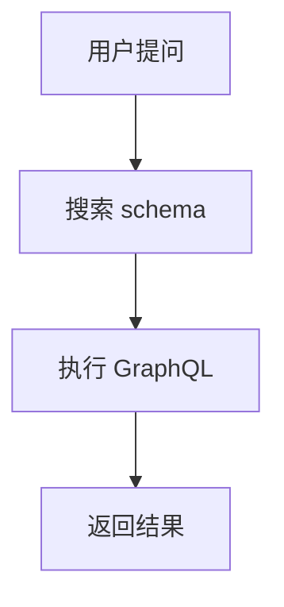
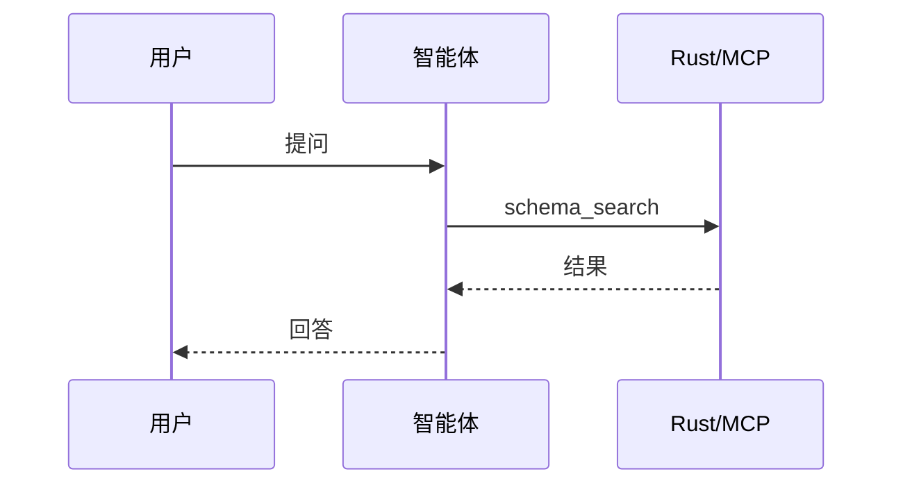
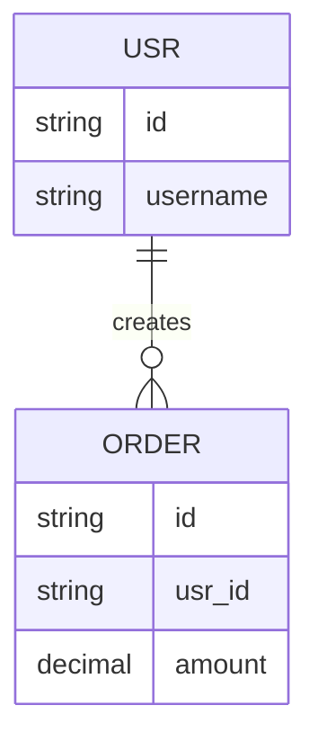
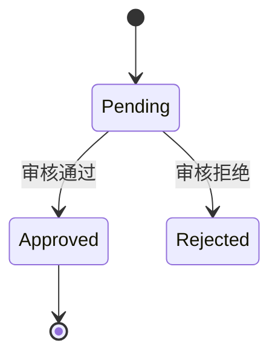

# Mermaid 图表规范

## 输出格式

只输出一个 `mermaid` 代码块：

````markdown

````

图后面用一句话说明关键路径。

## 规则

1. 业务流程用 `flowchart TD` / `flowchart LR`；交互时序用 `sequenceDiagram`；
   状态机用 `stateDiagram-v2`；数据模型用 `erDiagram`；类结构用 `classDiagram`。
2. 节点文本用双引号包裹：`A["订单创建"]`，避免括号、斜杠、冒号破坏语法。
3. 节点 id 用 ASCII（`A`、`step1`），不要用中文 id。
4. 不要用 HTML 标签（`<br>`、`<b>`）、不要用 `click` 交互、不要用外链图片。
   当前是 strict 模式，HTML label 会被清理。
5. 单个图不超过 20 个节点；超过时先分层或拆成多张图。
6. 不要在 mermaid 代码块里写注释、Markdown、JSON。
7. 数据趋势、占比、对比用 ECharts（`chart-report`），不要用 mermaid 画柱状图/饼图。

## 示例

### 时序图



### ER 图



### 状态图


